<!--
  This file is my GitHub profile page: github.com/prasadanubhav07 shows whatever is here.
  The pictures in assets/ are drawn by tools/build-assets.mjs (see the top of that file).
-->

<picture>
  <source media="(prefers-color-scheme: dark)" srcset="assets/header-dark.svg">
  
</picture>

 

Hi, I'm **Anubhav**, an undergraduate at **IIT Ropar** studying Integrated Circuit Design and Technology.

I like moving between fields. So far that has meant AI security and robustness, diffusion models and digital circuits. Embodied AI is next.

<!-- Each dot is glued to its name (no plain space between them), so a narrow screen never leaves a dot behind at the end of a line. -->

  &nbsp;<b>AI&nbsp;security and robustness</b>&nbsp;&nbsp;&nbsp;
  &nbsp;<b>Diffusion models</b>&nbsp;&nbsp;&nbsp;
  &nbsp;<b>Digital circuits</b>&nbsp;&nbsp;&nbsp;
  &nbsp;<b>Embodied&nbsp;AI</b>&nbsp;next

<picture>
  <source media="(prefers-color-scheme: dark)" srcset="assets/divider-dark.svg">
  
</picture>

### Things I've built

<table>
  <tr>
    <td width="50%" valign="top">
      <h4><a href="https://github.com/prasadanubhav07/talentpulse">talentpulse</a></h4>
      An AI agent that turns a job description into a ranked shortlist: it finds matching candidates, talks to them to gauge real interest, and scores each on match and interest.
        
      <code>Python</code>
    </td>
    <td width="50%" valign="top">
      <h4><a href="https://github.com/prasadanubhav07/PersonaMixer">PersonaMixer</a></h4>
      A chatbot with sliders for different personalities, to help you converse in all kinds of situations. Heavily inspired by Genshin Impact characters.
        
      <code>TypeScript</code> &nbsp;·&nbsp; <a href="https://persona-mixer.vercel.app">live demo</a>
    </td>
  </tr>
  <tr>
    <td width="50%" valign="top">
      <h4><a href="https://github.com/prasadanubhav07/Burger-vs.-Vada-Pav">Burger vs. Vada Pav</a></h4>
      A fun project I made to understand CNNs better.
        
      <code>Python</code>
    </td>
    <td width="50%" valign="top">
      <h4><a href="https://github.com/prasadanubhav07/program-timer">program-timer</a></h4>
      Tracks how long a task has been running and stops it when its timer runs out.
        
      <code>Python</code>
    </td>
  </tr>
</table>

<picture>
  <source media="(prefers-color-scheme: dark)" srcset="assets/divider-dark.svg">
  
</picture>

<!--
  When the portfolio site is live, add its address here, for example:

  
<a href="https://your-site-address/">Portfolio</a>

-->
